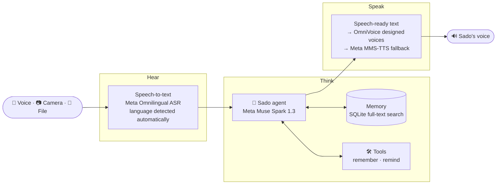

<div align="center">

# 🎙️ Sado

### One voice. Every language. Everywhere you are.

**Sado** is a voice-first AI companion that hears you, remembers you, and gets things done —<br/>
in the language you actually speak, not the one AI happens to support.

*Built on Meta's Muse models for the Meta Global AI Developer Hackathon 2026 · Indie track*

[](https://github.com/Bek1308/Sado/actions/workflows/ci.yml)

</div>

---

## 💡 The problem

Today's AI assistants are brilliant — **in about 25 languages.**

Meta's own real-time speech model, Muse Voice Transcribe, launches with 25 validated languages. Tajik, Uzbek and Russian are not among them. Neither are the languages of hundreds of millions of other people. And Meta Model API has no voice output at all.

So for a grandmother in Dushanbe, a builder in Samarkand, or a migrant worker reading a Russian contract at 2 a.m., *"just ask AI"* still means *"first, learn English."*

**Sado closes that gap.** It joins Meta's frontier reasoning with Meta's own open low-resource speech research, so anyone can talk to a real AI agent in their own language — and hear it answer back.

---

## 🧑‍🤝‍🧑 Meet Sado

Sado is not a chatbot with a microphone. It is a **character** — the same warm, witty, slightly old-fashioned companion wherever you meet it.

| Trait | What it means |
|---|---|
| 🗣️ **Speaks like you do** | Understands Tajik, Uzbek and Russian — and the way people mix them mid-sentence. |
| 🧠 **Remembers** | Names, routines, promises, documents you showed it last week. You can see and delete every memory. |
| 👀 **Sees** | Point your camera at a letter, a bill or a form. Sado reads it, explains it, and tells you what to do next. |
| 🛠️ **Acts** | Saves facts and sets reminders through real tool calls, and asks before anything changes. |
| 🎭 **Has a personality** | Consistent voice, humour and manners. Polite with elders, quick with students, precise at work. |

---

## 🌍 One companion, four places

Sado runs on one brain and one memory, and switches **modes** to fit where you are.

### 🏠 At home — *the family companion*
> **Grandma:** *"Sado, Rustam lands on Friday at 6. Remind me on Thursday evening."*
> **Sado:** *"Of course. I'll remind you on Thursday at 7 in the evening."*

Hands-free talk: speak, pause, and Sado answers and listens again. No buttons, no typing.

### 🙋 For you — *the personal assistant*
> **You:** *"Sado, remember my car insurance ends in March — and tell me two weeks before."*

Notes, plans, reminders and personal knowledge — searchable by voice.

### 💼 At work — *the agent*
> **You** *(shares a contract PDF)*: *"What do I have to pay, and by when?"*

Brief, professional answers: Sado reads PDFs and Office files and pulls out the names, dates and amounts that matter.

### 🧭 On the go — *the explainer*
> **Migrant worker** *(photographs a Russian document)*: *"What is this?"*
> **Sado** *(in Tajik)*: *"This is a notice about your work permit. It expires on 15 November. Here is what to do…"*

Camera-first: understand any paper, in any language, in seconds.

---

## ⚙️ How it works



1. **Hear** — Meta's open-source **Omnilingual ASR** (LLM 1B) transcribes Tajik, Uzbek, Russian and English. Sado works out which language you spoke, so there is no language picker.
2. **Think** — **Muse Spark** answers as Sado, in a mode that fits the moment (Home, Personal, Work, On the go). It calls tools to save facts and set reminders, and reads photos, PDFs, Office files and recordings.
3. **Remember** — Facts are stored locally and recalled with full-text search tuned for Tajik and Uzbek word endings. The app shows every memory and lets you delete it.
4. **Speak** — Numbers, dates and money are written out the way each language says them, then spoken in one of six designed voices, in the mood you choose.

---

## 🧩 What runs where

| Model | Role in Sado | By |
|---|---|---|
| **Muse Spark 1.3** (Model API) | The brain: conversation, tool calls, reading photos and documents | Meta |
| **Omnilingual ASR** LLM 1B | Listening in all four languages | Meta FAIR, open source |
| **MMS-TTS** | Fallback voice when the main voice is unavailable | Meta, open source |
| **OmniVoice** | Sado's main voice: designed voices and moods | k2-fsa, open source (Apache-2.0) |

Meta's hosted speech model, Muse Voice Transcribe, does not cover Tajik, Uzbek or Russian, and the Model API has no text-to-speech — which is exactly why Sado brings open speech models alongside Muse Spark.

---

## 🗺️ Languages

| Language | Listen | Speak | Status |
|---|:-:|:-:|---|
| Tajik | ✅ | ✅ | Working |
| Uzbek (Latin) | ✅ | ✅ | Working |
| Russian | ✅ | ✅ | Working |
| English | ✅ | ✅ | Working |
| Any of 1,600+ Omnilingual languages | 🔜 | 🔜 | Pluggable language packs |

Adding a language means adding a **language pack** — speech models, voice and normalisation rules — not rewriting Sado.

---

## 🔒 Trust by design

- **You own the memory.** View, edit or delete anything Sado remembers.
- **Ask before acting.** Reminders Sado sets show up in the app for you to confirm.
- **Knows its limits.** No medical, legal or financial advice — Sado explains documents and points you to real help.

---

## 🚀 Run it yourself

**Server** (Python 3.12, [uv](https://docs.astral.sh/uv/), an NVIDIA GPU for the voices):

```bash
cd server
cp .env.example .env            # then set SADO_META_API_KEY from dev.meta.ai
uv sync --extra speech
uv run uvicorn sado.main:app --port 8000
```

**Speech recognition worker** (Linux or WSL, because fairseq2 has no Windows build):

```bash
bash server/scripts/download_models.sh
cd server/workers && ~/.venvs/sado-models/bin/python -m uvicorn omnilingual_asr_worker:app --port 8011
```

**App** (Flutter 3.44):

```bash
cd mobile
flutter run --dart-define=SADO_API_URL=http://<your-server>:8000
```

Checks: `uv run pytest` and `uv run mypy src` in `server/`, `flutter test` and `dart analyze` in `mobile/`.

---

## 🚧 Build log

Sado is being built live during the hackathon. All code in this repository was written from **27 October 2026**, partly with Meta's own coding agent, **Muse Code**.

📐 [Engineering principles](docs/ENGINEERING.md) · 🗺️ [Roadmap](docs/ROADMAP.md) · 🤖 [Agent guide](AGENTS.md)

- [x] Foundations: server and mobile skeletons, Clean Architecture, CI
- [x] Speak: six designed voices, six moods, speech-ready text in four languages
- [x] Hear: Meta Omnilingual ASR for Tajik, Uzbek, Russian and English, language detected automatically
- [x] Think: Muse Spark agent loop with tools, on the user's own clock
- [x] Remember: memories saved by voice or by hand, recalled when relevant, visible and deletable
- [x] See: explain photos, PDFs, Office files and recordings
- [x] Act: reminders the agent sets and mentions when due
- [x] Character: animated robot face that follows mood and activity
- [x] Modes: Home · Personal · Work · On the go
- [x] Live talk: hands-free conversation, silence ends the turn
- [ ] Hosted backend for judges
- [ ] Demo video

---

<div align="center">

**Sado** — *"voice" in Tajik and Uzbek.*<br/>
Because everyone deserves an AI that speaks their language.

</div>
