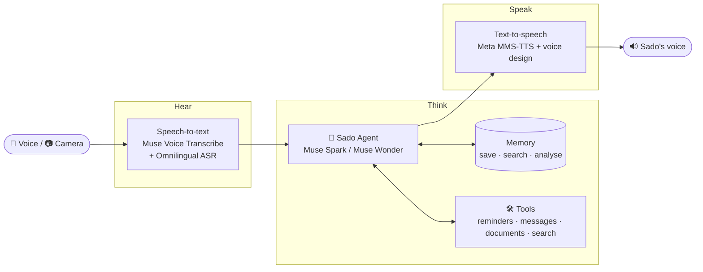

# 🎙️ Sado

### One voice. Every language. Everywhere you are.

**Sado** is a voice-first AI companion that hears you, remembers you, and gets things done — 
in the language you actually speak, not the one AI happens to support.

*Built on Meta's Muse models for the Meta Global AI Developer Hackathon 2026 · Indie track*

---

## 💡 The problem

Today's AI assistants are brilliant — **in about 25 languages.**

Meta's own real-time speech model, Muse Voice Transcribe, launches with 25 validated languages. Tajik, Uzbek and Russian are not among them. Neither are the languages of hundreds of millions of other people. And Meta Model API has no voice output at all.

So for a grandmother in Dushanbe, a builder in Samarkand, or a migrant worker reading a Russian contract at 2 a.m., *"just ask AI"* still means *"first, learn English."*

**Sado closes that gap.** It joins Meta's frontier reasoning with Meta's own open low-resource speech research, so anyone can talk to a real AI agent in their own language — and hear it answer back.

---

## 🧑‍🤝‍🧑 Meet Sado

Sado is not a chatbot with a microphone. It is a **character** — the same warm, witty, slightly old-fashioned companion wherever you meet it.

| Trait | What it means |
|---|---|
| 🗣️ **Speaks like you do** | Understands Tajik, Uzbek and Russian — and the way people mix them mid-sentence. |
| 🧠 **Remembers** | Names, routines, promises, documents you showed it last week. You can see and delete every memory. |
| 👀 **Sees** | Point your camera at a letter, a bill or a form. Sado reads it, explains it, and tells you what to do next. |
| 🛠️ **Acts** | Sets reminders, drafts messages, searches, fills in forms, keeps lists — through real tool calls, not just words. |
| 🎭 **Has a personality** | Consistent voice, humour and manners. Polite with elders, quick with students, precise at work. |

---

## 🌍 One companion, four places

Sado runs on one brain and one memory, and switches **modes** to fit where you are.

### 🏠 At home — *the family companion*
> **Grandma:** *"Sado, what did Rustam say about coming home?"*
> **Sado:** *"He wrote yesterday — he lands on Friday at 6. Want me to remind you Thursday evening?"*

Hands-free reminders, family messages read aloud, gentle daily routines.

### 🙋 For you — *the personal assistant*
> **You:** *"Sado, remember my car insurance ends in March — and tell me two weeks before."*

Notes, plans, reminders and personal knowledge — searchable by voice.

### 💼 At work — *the agent*
> **You:** *"Read these three invoices, compare them, and draft a reply to the cheapest supplier."*

Multi-step tasks: read documents, extract data, compare, write, and save the result.

### 🧭 On the go — *the explainer*
> **Migrant worker** *(photographs a Russian document)*: *"What is this?"*
> **Sado** *(in Tajik)*: *"This is a notice about your work permit. It expires on 15 November. Here is what to do…"*

Camera-first: understand any paper, in any language, in seconds.

---

## ⚙️ How it works

1. **Hear** — The right speech model is picked per language. Supported languages use Muse Voice Transcribe in real time. Tajik and Uzbek use Meta's open-source Omnilingual ASR.
2. **Think** — Muse Spark plans, reasons over images and calls tools. Long-running tasks use Muse Wonder's memory and focus.
3. **Remember** — Every fact Sado learns is stored, searchable and analysable — and fully visible to the user.
4. **Speak** — Answers are normalised for speech (numbers, dates, money become words) and spoken in Sado's own voice.

---

## 🧩 Meta AI inside

| Meta model | Role in Sado |
|---|---|
| **Muse Spark** | The brain: multimodal reasoning, tool use, document understanding |
| **Muse Wonder** | Long, multi-step agent tasks with active memory |
| **Muse Voice Transcribe** | Real-time listening for supported languages |
| **Omnilingual ASR** *(Meta FAIR, open source)* | Listening in Tajik, Uzbek and other low-resource languages |
| **MMS-TTS** *(Meta, open source)* | Sado's voice in languages no API speaks yet |
| **Muse Image** | Sado's look and visual answers |

---

## 🗺️ Languages

| Language | Listen | Speak | Status |
|---|:-:|:-:|---|
| Tajik | ✅ | ✅ | Planned for first release |
| Uzbek | ✅ | ✅ | Planned for first release |
| Russian | ✅ | ✅ | Planned for first release |
| English | ✅ | ✅ | Planned for first release |
| Any of 1,600+ Omnilingual languages | 🔜 | 🔜 | Pluggable language packs |

Adding a language means adding a **language pack** — speech models, voice and normalisation rules — not rewriting Sado.

---

## 🔒 Trust by design

- **You own the memory.** View, edit or delete anything Sado remembers.
- **Ask before acting.** Sado confirms before sending a message or changing anything.
- **Knows its limits.** No medical, legal or financial advice — Sado explains documents and points you to real help.

---

## 🚧 Build log

Sado is being built live during the hackathon. All code in this repository was written from **27 October 2026**.

📐 [Engineering principles](docs/ENGINEERING.md) · 🗺️ [Roadmap](docs/ROADMAP.md)

- [x] Foundations: server and mobile skeletons, Clean Architecture, CI
- [ ] Flutter app: voice button, camera, Sado's face
- [x] Hear: speech-to-text with Meta Omnilingual ASR (LLM 1B) for Tajik, Uzbek, Russian, English
- [ ] Think: Muse Spark agent loop with tools
- [ ] Remember: memory store with search and analysis
- [ ] Speak: TTS with speech-ready text normalisation
- [ ] Modes: Home · Personal · Work · On the go
- [ ] Demo video

---

**Sado** — *"voice" in Tajik and Uzbek.* 
Because everyone deserves an AI that speaks their language.

